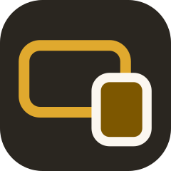
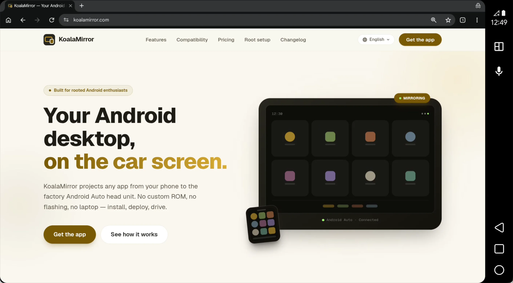

# KoalaMirror

**Full Android on your car screen — a real second display, not a copy of your phone's.**

[Español](https://koalamirror.com/es) · [Português](https://koalamirror.com/pt) · [Français](https://koalamirror.com/fr) · [한국어](https://koalamirror.com/ko) · [日本語](https://koalamirror.com/ja) · [繁體](https://koalamirror.com/zh-tw)

The head unit gets its own Android display: its own launcher, its own input focus, its own power group. Your phone screen can be off, or doing something else entirely, while the car runs any app you like.

> [!IMPORTANT]
> **Root required** — Magisk, KernelSU, or APatch. There is no no-root path: the display flags this depends on are gated by a platform permission that ADB shell cannot hold. If your phone isn't rooted, [KM Launcher](https://play.google.com/store/apps/details?id=com.koalamirror.launcher) is our free no-root car home screen instead.

Google DHU emulator — not a photo of a car.

## How it works

A Zygisk module loads into **`system_server`** and into **gearhead**, Android Auto's own process. That placement is the whole design: everything below is done from inside those two processes, not by calling into them from outside.

In `system_server` it creates the car's display, with the flags that make it a real one rather than a scratch surface:

- **`TRUSTED`** — a first-class display, which is what lets arbitrary apps be started on it. Requires `ADD_TRUSTED_DISPLAY`, declared `signature|role`, and it's not in `packages/Shell/AndroidManifest.xml` — so it is out of reach for anything driven over ADB shell.
- **`OWN_DISPLAY_GROUP`** — its own power group, so the car screen keeps running when the phone's sleeps
- **`ALWAYS_UNLOCKED`** — it isn't stuck behind the phone's keyguard
- **`OWN_FOCUS`** (Android 14+) — it holds its own input focus

In gearhead it changes how Android Auto itself behaves — the navigation bar, the display density, which key events belong to the car. **No amount of permission gets a Binder client there**; running inside the host process is a different kind of access than calling it.

## Driving it from the car's own controls

Making a phone UI usable from a steering wheel, a rotary knob, or a car's own buttons is most of the engineering.

**Keys.** Eleven steering-wheel keycodes (`79 85 86 87 88 89 90 91 126 127 130`) are forwarded to the projected side, with long-press overloads — `89` returns to the car launcher, `90` switches to the previous app. **Anything not in that table is handed back to Android Auto untouched.**

That last part is the one we got wrong for a long time. Wrapping a receiver means anything you intercept never reaches AA's original one, and our first implementation intercepted everything — so any key we didn't recognise was silently swallowed for as long as projection was running. It shipped that way from the first release until 1.3.1, on every car. It got fixed because a user photographed the diagnostic toast on his phone (`Steering key [65538] not mapped`) and sent it in.

**Rotary and D-pad head units.** Mazda Commander, BMW iDrive, Audi MMI — no touchscreen at all. Scroll wheel events (`VSCROLL`/`HSCROLL`/`SCROLL`) become `NAVIGATE_NEXT`/`PREVIOUS` focus moves, and the projected display is taken out of touch mode with `setInTouchMode(false, displayId)` — without that, Android hands focus to nothing and D-pad presses do literally nothing.

**Navigation bar.** Home / Recents / Back live inside gearhead's own view tree: our bar is laid over Android Auto's coolwalk rail, and AA's own widgets behind it are taken out of the focus order so a rotary knob can't land on something invisible. It's part of AA's UI, not a floating window drawn over it.

**Handing focus back.** Press Home on that bar and focus has to travel from the bar into the projected area — which meant synthesising the arrow key the user would otherwise press. Four approaches failed first: `InputManager.injectInputEvent` from `system_server` (AA doesn't accept those as car keys), `view.dispatchKeyEvent`, injecting at the bar's ViewRootImpl (the listener fired, focus didn't move), and replaying through the projected activity's `onKeyDown` (the host returned `handled=false`). Car keys are arbitrated in AA's own `:car` process before any window sees them — **the only thing that works is being in that process.**

## Features

- **Startup app / Home app** — what opens when projection starts, and where the car's Home key goes
- **Display density** — set the projected display's DPI independently of the phone (0 follows the phone)
- **Recents panel** on the car screen, plus push-to-car from the phone
- **Keyboard target** — IME on the car screen or kept on the phone
- **Car wallpaper** — follow the phone's, or a separate image
- **Keep-alive** — how long the display survives a disconnect
- **Shell hooks** — root commands before projection starts and after it stops, one per line

No Android Auto developer options required — you don't need to tap Version ten times or route the install through a spoofing installer. Android Auto can shift what projection takes from one release to the next, so the app tracks versions rather than assuming.

## Requirements

| | |
|---|---|
| **Root** | Magisk, KernelSU, or APatch. Needs a Zygisk runtime — provisioned during Deploy if yours doesn't ship one. |
| **Android** | 12L–16 (SDK 32+), with Google Mobile Services |
| **Android Auto** | 16.7–17.4 — the range we track and adapt to |

Behaviour differs by Android version and you should know which side you're on: `OWN_FOCUS` and per-display `setInTouchMode` are Android 14+ (12L/13 fall back to the global API); on Android 16 the platform's `DisplayGroupAllocator` overrides `OWN_DISPLAY_GROUP`, so the group is reclaimed by hooking `LogicalDisplayMapper.assignDisplayGroupLocked`. ROM-specific `services.jar` differences are a known variable.

Not every Android Auto point release gets its own device pass; the app checks the AA version and degrades rather than breaking.

## Free and licensed

The split falls where the architecture does: the display itself is free, changing Android Auto's own behaviour is not.

**Free, forever, no card:** the car display, with [KM Launcher](https://play.google.com/store/apps/details?id=com.koalamirror.launcher) as its home screen — open any app on your phone from there and it runs on the car screen. Android Auto's own shell stays stock.

**Licensed:** the parts that live inside gearhead — the injected navigation bar, steering-wheel and rotary key handling, display density — plus editable projection settings. Signing in starts a 30-day trial of all of it; after that the free tier keeps working. [Pricing](https://koalamirror.com/#pricing).

## Install

Install the APK → **Deploy** → reboot → connect to the car as usual.

[Setup guides & troubleshooting](https://koalamirror.com/guides) · [**Latest release**](https://github.com/koalaauto/KoalaMirror/releases/latest)

## Lineage

This started from [a personal fork](https://github.com/koalaauto/AADisplay-Beta) of [Nitsuya/AADisplay](https://github.com/Nitsuya/AADisplay) — an LSPosed module that puts apps on the Android Auto screen through a VirtualDisplay. That fork is archived and remains GPL-3.0; credit to [@Nitsuya](https://github.com/Nitsuya) for the original work.

KoalaMirror does not carry that code. It was rebuilt independently as a Zygisk module injecting `system_server` and gearhead, rather than an Xposed/LSPosed module.
