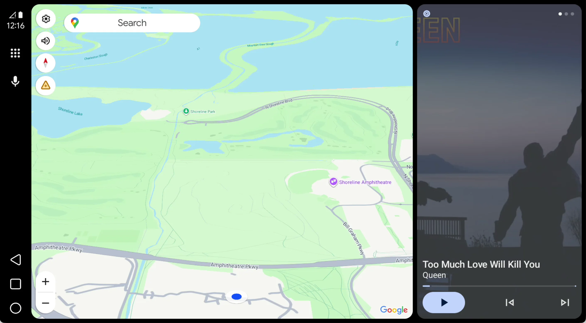
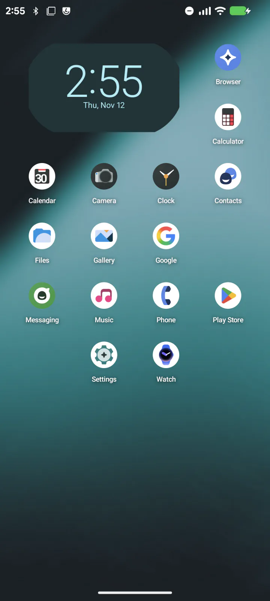

# KoalaMirror

**Your whole phone, on the car screen.**

Three Android apps for drivers who want their whole phone on the dash.

[koalamirror.com](https://koalamirror.com) · [Guides](https://koalamirror.com/guides) · [FAQ](https://koalamirror.com/faq) · [Changelog](https://koalamirror.com/changelog)

[中文](https://koalamirror.com/zh) · [繁體](https://koalamirror.com/zh-tw) · [Español](https://koalamirror.com/es) · [Português](https://koalamirror.com/pt) · [Français](https://koalamirror.com/fr) · [한국어](https://koalamirror.com/ko) · [日本語](https://koalamirror.com/ja)

| App | What it is | Root | Car side |
|---|---|---|---|
| [**KM Space**](https://koalamirror.com/space) | A second Android inside your phone | Not needed | Wireless CarPlay |
| [**KM Auto**](https://koalamirror.com/auto) | Your full Android desktop on the factory Android Auto screen | Required | Android Auto |
| [**KM Launcher**](https://koalamirror.com/launcher) | A minimal home screen for the car | Not needed | Any Android screen |

Each app works on its own.

## KM Space

A complete Android 13 that runs inside an ordinary app. No root.

- Google Play inside, with its own Google account and its own apps.
- Copy and paste, notifications, the microphone and location pass between the phone and a Space when you turn them on.
- A Space goes on the car screen over wireless CarPlay.

Coming to Google Play. The first 30 days are free, including the car. [Learn more](https://koalamirror.com/space)

## KM Auto

*Formerly KoalaMirror.* Puts your whole Android desktop on the car's own Android Auto screen, with no flashing and no developer options. Any app runs on the car display while your phone screen stays off.

Two phone apps side by side on the car display. Google DHU emulator, not a photo of a car.

- **Root required**: Magisk, KernelSU or APatch.
- Android 12L to 17 with Google Play services, Android Auto 16.7 to 18.0.
- Free Basic mode. Full features are a paid plan with a 30-day trial.

[Download and setup](https://koalamirror.com/auto)

## KM Launcher

A free, minimal home screen made for car displays: large tiles, an editable grid, widgets and a low-distraction dark theme. Works with KM Auto or on its own. Android 8.1 and up, no root.

[Get it on Google Play](https://play.google.com/store/apps/details?id=com.koalamirror.launcher)

## Downloads

Every download is on [koalamirror.com](https://koalamirror.com) or Google Play. This repository does not host APKs.

## Lineage

KM Auto started from [a personal fork](https://github.com/koalaauto/AADisplay-Beta) of [Nitsuya/AADisplay](https://github.com/Nitsuya/AADisplay), an LSPosed module that puts apps on the Android Auto screen through a VirtualDisplay. That fork is archived and remains GPL-3.0; credit to [@Nitsuya](https://github.com/Nitsuya) for the original work. KM Auto does not carry that code: it was rebuilt independently.

## Contact

[support@koalamirror.com](mailto:support@koalamirror.com)
